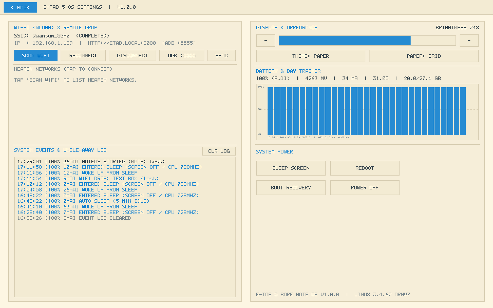
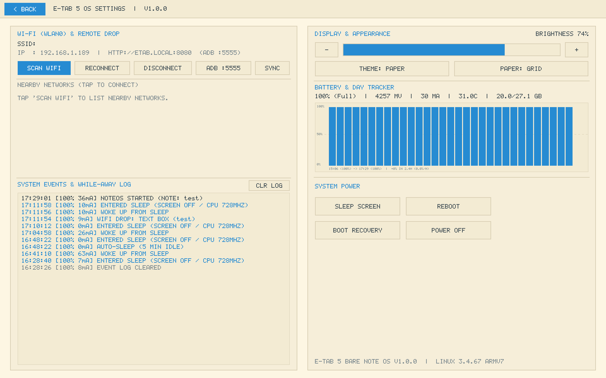

# E-Tab 5 Bare Note OS (`etab5-noteos`)

A standalone, bare-Linux note-taking OS written in C for the **General Mobile E-Tab 5** (MediaTek MT8392 / ARMv7, 10.1" 1920×1200 IPS display, Wacom I2C EMR stylus, 2 GB RAM, 32 GB eMMC).

Android (`zygote`, `surfaceflinger`, `system_server`, Dalvik/ART) is completely disabled at boot. The tablet boots directly from the stock Linux 3.4.67 kernel into a ~246 KB static ARMv7 binary rendering directly to `/dev/graphics/fb0`, using ~60 MB total system RAM (~1.95 GB free).

<p align="center">
  
  
</p>

## Features

- **Direct Framebuffer Rendering:** Double-buffered dirty-rect renderer on 1920×1200 ARGB8888 (`/dev/graphics/fb0`) with instant visual press feedback on every button.
- **Wacom EMR Stylus & Hardware Palm Rejection:** Sub-pixel coordinates (`21696×13560`), 1024-level pressure sensitivity, hover cursor, flip eraser, and hardware palm rejection (capacitive multi-touch drives UI buttons only).
- **Stylus Radial Menu:** Side button opens an 8-wedge circular menu (`PEN`, `BRUSH`, `PENCIL`, `HI`, `ERASE`, `SIZE`, `UNDO`, `REDO`) + 5-color swatch bar (supports hold-glide-release and click-tap).
- **Notebooks, Folders, Images & Text Boxes:** Atomic `.enote` vector files under `/data/noteos/notes/` with nested folders, note renaming, moving notes between folders, multi-page notebooks, object eraser, unlimited per-page undo/redo, movable/resizable dropped images, and editable text boxes.
- **Obsidian-Style Markdown Visualizer:** Native `.md` reader with YAML frontmatter, headings, tappable `- [ ]` / `- [x]` checklists, code blocks, blockquotes, Turkish UTF-8 glyphs, and two-way vault sync (`./scripts/sync_engram.py`).
- **Zero-Config `etab.local` & Wi-Fi Drop:** Built-in mDNS responder (`etab.local`) + HTTP Drop server (`http://etab.local:8080`) to paste images or text from a phone or computer straight onto the active page.
- **Standalone OS Settings (Gear Icon):** Native Wi-Fi scanner/connector (`wpa_cli`) with partial-redraw on-screen QWERTY keyboard, brightness slider, theme (`LIGHT` / `PAPER` / `DARK`) & paper (`LINED` / `GRID` / `BLANK`) selectors, live battery/storage diagnostics, **24-hour Battery Day Tracker chart**, **System Events & While-Away Log**, ADB-over-Wi-Fi control (`:5555`), software version indicator (`v1.0.0`), and 2-tap confirmed sleep/reboot/TWRP/power-off controls.
- **Standalone DHCPv4 Daemon:** Custom ~28 KB static RFC 2131 DHCP client (`noteos-dhcp`) bringing up Wi-Fi automatically on boot without Android.
- **Low-Power Sleep & Auto-Sleep:** IEEE 802.11 Wi-Fi power-save, single-core `powersave` CPU scaling (`728 MHz`), MediaTek Smart-Book suspend/resume, display blanking, zero-wakeup `poll()`, and a 5-minute inactivity auto-sleep timer.

## Hardware Target

| Component | Spec / Linux Interface |
| :--- | :--- |
| **Device / SoC** | General Mobile E-Tab 5 · MediaTek MT8392 (ARMv7 Cortex-A7) · 2 GB RAM · 32 GB eMMC |
| **Kernel** | Stock Linux `3.4.67` (`armv7l`, SMP PREEMPT) |
| **Display** | `/dev/graphics/fb0` (1920×1200 @ 32bpp, triple-buffered) |
| **Stylus** | `Wacom I2C Digitizer` (`/dev/input/event1`, Vendor `056a`) |
| **Touch** | `mtk-tpd` (`/dev/input/event4`) |
| **Hardware Keys** | `mtk-kpd` (`/dev/input/event0` — Power, Vol+, Vol-) |
| **Partitions** | `bootimg` (10 MB), `recovery` (10 MB, TWRP kept intact), `usrdata` (~27 GB) |

## Project Structure

```text
include/
  types.h       Version, core enums, themes, stroke/page/doc structs, overlay states
  app.h         Top-level App state & lifecycle API
  fb.h          Framebuffer driver, backlight, drawing primitives, gear icon & UTF-8 font
  render.h      Paper templates, AA ink/brush/pencil/highlighter & radial menu renderer
  storage.h     Stroke/Page/NoteDoc operations & atomic .enote / folder CRUD
  prefs.h       Persistent user preferences (/data/noteos/prefs.conf)
  osk.h         On-screen QWERTY keyboard (partial redraw + press highlight)
  settings.h    OS Settings page, battery tracker, system events log & wpa_cli Wi-Fi
  ui.h          Toolbar, folder/note sidebar, move-note picker & radial actions
  input.h       Wacom EMR, capacitive touch & hardware key event loop
  md.h          Obsidian-style Markdown parser & interactive checklist renderer
  mdns.h        Zero-config mDNS responder (etab.local)
  drop.h        HTTP Wi-Fi Drop server (:8080)
src/            C implementations corresponding to include/ + stb_impl.c
daemons/
  dhcpc.c       Standalone static RFC 2131 DHCPv4 client daemon (noteos-dhcp)
third_party/
  stb_image.h   Single-header PNG/JPEG image decoder
scripts/
  build_bootimg.py  Pure-Python MediaTek bootimg repacker
  deploy.sh         Hot-deploy /data/noteos/noteos over ADB (no reflash needed)
  drop.sh           Send macOS clipboard or image file to http://etab.local:8080/drop
  sync_engram.py    Two-way Markdown vault sync over ADB
PLAN.md         Phased roadmap
LOG.md          Chronological build & hardware command log
```

## Installation Guide

> **Disclaimer:** Flashing `/dev/bootimg` modifies your tablet's boot partition. Keep **TWRP** installed in `/dev/recovery` and store a verified copy of your stock `bootimg.img` before flashing. Proceed at your own risk.

### Prerequisites
- A **rooted** General Mobile E-Tab 5 with **USB Debugging enabled** and **TWRP** installed in `recovery` (used as a safety net — never modified by this project).
- On your host machine (macOS or Linux):
  - [`zig`](https://ziglang.org/) (used as a zero-setup static `arm-linux-musleabihf` C cross-compiler)
  - `adb` (`android-platform-tools`)
  - `python3`

### 1. Back Up Stock `bootimg` & `recovery` (Required)

Connect your tablet over USB and dump both partitions into `backups/` (ignored by git):

```bash
mkdir -p backups

adb shell "su -c 'dd if=/dev/bootimg of=/data/local/tmp/bootimg.img bs=131072 && dd if=/dev/recovery of=/data/local/tmp/recovery.img bs=131072 && chmod 644 /data/local/tmp/*.img'"
adb pull /data/local/tmp/bootimg.img backups/bootimg.img
adb pull /data/local/tmp/recovery.img backups/recovery.img

# Keep a backup copy on the tablet too for instant recovery
adb shell "su -c 'mkdir -p /data/noteos && cp /data/local/tmp/bootimg.img /data/noteos/stock_bootimg.img'"

# Record SHA-256 checksums
shasum -a 256 backups/bootimg.img backups/recovery.img
```

### 2. Build the Binaries (or Download from Releases)

```bash
# Cross-compile static ARMv7 binaries (build/noteos + build/noteos-dhcp)
make
```

*(Alternatively, download `noteos` and `noteos-dhcp` from the [Releases](../../releases) page and place them in `build/`.)*

### 3. Optional: Test Live Without Flashing

You can pause Android temporarily and run `noteos` directly on the framebuffer before touching `/dev/bootimg`:

```bash
adb push build/noteos /data/local/tmp/noteos
adb shell "su -c 'chmod +x /data/local/tmp/noteos && stop && /data/local/tmp/noteos; start'"
```

### 4. Repack & Flash Standalone `bootimg`

`scripts/build_bootimg.py` takes your `backups/bootimg.img`, preserves the exact stock Linux 3.4.67 kernel and MediaTek headers, disables Android userspace in `init.rc`, and embeds `noteos`, `noteos-dhcp`, Wi-Fi init, and `adbd` (`:5555` + USB) into the ramdisk:

```bash
# Build build/bootimg_noteos.img
make bootimg

# Push to tablet and flash /dev/bootimg
adb push build/bootimg_noteos.img /data/noteos/bootimg_noteos.img
adb shell "su -c 'dd if=/data/noteos/bootimg_noteos.img of=/dev/bootimg bs=131072 && sync'"

# Verify on-flash SHA-256 matches build/bootimg_noteos.img
SIZE_BLOCKS=$(( $(stat -f%z build/bootimg_noteos.img 2>/dev/null || stat -c%s build/bootimg_noteos.img) / 2048 ))
shasum -a 256 build/bootimg_noteos.img
adb shell "su -c 'dd if=/dev/bootimg bs=2048 count=${SIZE_BLOCKS} 2>/dev/null | sha256sum'"

# Clean up temp image and reboot into Bare Note OS
adb shell "su -c 'rm -f /data/noteos/bootimg_noteos.img && reboot'"
```

### 5. Hot-Deploying Updates (No Reflash Needed)

Once running standalone Bare Note OS, `init` launches `/data/noteos/noteos` if present (falling back to `/sbin/noteos` in the ramdisk). After any code edit, update live in ~1 second:

```bash
make deploy
```

### 6. Wi-Fi Drop & Markdown Vault Sync

```bash
# Drop current macOS clipboard (image or text) or a file onto the active note page
./scripts/drop.sh
./scripts/drop.sh photo.png

# Two-way sync with any local Obsidian / Markdown vault
NOTES_DIR=~/path/to/vault ./scripts/sync_engram.py
NOTES_DIR=~/path/to/vault ./scripts/sync_engram.py --fresh   # clean overwrite on tablet
```

### 7. Restoring Stock Android

At any time, restore your backed-up `bootimg.img` over ADB (or from TWRP Recovery via Vol+ & Power):

```bash
adb shell "su -c 'dd if=/data/noteos/stock_bootimg.img of=/dev/bootimg bs=131072 && sync && reboot'"
```

## Roadmap

- [x] Hardware discovery, SHA-256 verified backups (`bootimg` & `recovery`), framebuffer + Wacom validation
- [x] Core Note OS (`noteos`): pens/brush/pencil/highlighter, radial menu, folders, move/rename, persistent prefs, OS settings & Wi-Fi
- [x] Standalone `bootimg` (0% Android, boots straight into `noteos` + Wi-Fi + `noteos-dhcp` + `adbd :5555`)
- [x] Obsidian-style Markdown viewer, Wi-Fi Drop (`etab.local:8080`), low-power sleep, Battery Day Tracker & System Events log (`v1.0.0`)
- [ ] Always-on Raspberry Pi sync bridge + lightweight native Home Assistant control panel

## License

[MIT](LICENSE)
